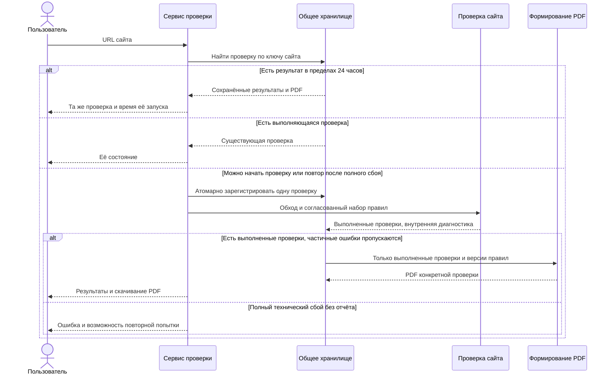

# MVP: бесплатная проверка сайта

Статус: согласован продуктовый объём MVP и первый набор проверок; технические параметры и правовая методика требуют детализации перед реализацией. Дата фиксации: 15 октября 2026 года. История — в [decisions.md](decisions.md).

## Цель и текущее состояние

Пользователь — владелец любого сайта, деятельность которого подпадает под применимые требования РФ. Домен `.ru` или `.рф` не является обязательным условием. Пользователь должен узнать о найденных нарушениях и потенциальных штрафах, получить ссылки на действующее законодательство и полное ТЗ по исправлению каждой находки.

Сейчас существуют документация, утверждённый стек и правила разработки. Приложение, сканер, проверки, API, PDF-генерация и продуктовые тесты ещё не реализованы. Дизайн в Stitch предстоит согласовать после закрытия требований.

## Согласованные требования

| ID | Требование | Критерий приёмки |
| --- | --- | --- |
| BR-001 | На первом этапе весь функционал бесплатен | Нет оплаты, тарифных ограничений доступа к результатам, скрытых платных находок и обязательной покупки PDF |
| BR-002 | MVP работает без регистрации и без ИИ | URL можно отправить без аккаунта; проверки и ТЗ используют воспроизводимые правила и подготовленные шаблоны, без LLM/API ИИ |
| BR-003 | Небольшой обход: до 20 HTML-страниц и найденные правовые документы | Отчёт содержит только фактически проверенные URL и документы; документ учитывается отдельно от лимита HTML-страниц; частичные ошибки в отчёт не включаются |
| BR-004 | Выполнение JavaScript отложено на будущее | Сервис не обещает проверку отрисованных только через JS форм, состояний баннера и поведения трекеров; неизвестное не считается успешной проверкой |
| BR-005 | Один новый запуск для сайта за 24 часа с момента запуска | Повторный запрос любого пользователя в течение окна возвращает ту же проверку и сохранённые данные; после истечения окна новый запрос может создать новую проверку |
| BR-006 | Лимит общий для всех пользователей | Лимит определяется сайтом, а не IP, браузером или аккаунтом; одновременно не создаются независимые проверки одного сайта |
| BR-007 | `www` и основной hostname — один сайт; остальные поддомены — отдельные сайты | `http://example.ru/a` и `https://www.example.ru/b?utm_source=x` используют общий результат; `shop.example.ru` имеет отдельное окно |
| BR-008 | После полного технического сбоя без отчёта повтор разрешён до истечения 24 часов | Неудачная проверка не блокирует возможность получить результат; конкурентные повторы по-прежнему объединяются; частичные ошибки не переводят проверку в неудачную |
| BR-009 | PDF — обязательный результат | Пользователь может скачать PDF с выполненными проверками, правовыми основаниями, диапазонами санкций и полным ТЗ; PDF соответствует конкретной версии проверки |
| BR-010 | Штрафы показываются по категориям лиц | Раздельные диапазоны для граждан, должностных лиц, ИП и организаций; первичность/повторность и специальные условия описаны явно |
| BR-011 | Нет неподтверждённого сложения штрафов | Один факт и альтернативные квалификации не создают дубли; без подтверждённой методики нет общей суммы из механически сложенных максимумов |
| BR-012 | Все правила ведутся отдельным расширяемым каталогом | В [каталоге](../../violations.md) есть устойчивые ID, условия применимости, основания, возможности автоматизации и очередь реализации |
| BR-013 | Функционал вводится постепенно | Проверка выполняет только реализованные и проверенные правила; каталог будущих правил не выдаётся за покрытие MVP |
| BR-014 | Первый набор — доступность политики/сведений о защите и признаки согласия в HTML-формах | Включены PD-001, PD-002, PD-005 и PD-006 в описанных ниже границах; результаты содержат доказательства, ТЗ и денежную оценку только при подтверждённой применимости |
| BR-015 | Для каждой найденной проблемы подготовлено полное ТЗ | Указаны затронутые URL/формы, требуемые действия, ожидаемый результат, необходимые сведения владельца и проверяемые критерии приёмки |
| BR-016 | Ссылки ведут на применимые действующие нормы | Для правила сохранены акт, статья/пункт, редакция, дата вступления, официальная ссылка и дата сверки; будущие изменения не применяются раньше времени |
| BR-017 | Можно проверить любой публичный сайт без подтверждения владения | Любой пользователь по адресу сайта может получить общий результат; публичного каталога отчётов и их индексации поисковиками нет |
| BR-018 | Срок хранения результатов и PDF — 24 часа от запуска проверки | Окно повторного использования и срок хранения заканчиваются одновременно; после этого старый PDF и результат по ссылке недоступны; служебные данные о лимите не должны случайно открывать удалённый отчёт |
| BR-019 | Входные правовые документы — HTML и текстовые PDF | Проверка неподдерживаемого формата или PDF-скана не входит в пользовательский результат; отсутствие извлечённого текста не трактуется как отсутствие документа или нарушение |
| BR-020 | Частичные ошибки не входят в результат; проверка считается успешной | Пользователь видит только фактически выполненные проверки и их находки. Ошибки отдельных страниц, документов или правил сохраняются во внутренней диагностике, не показываются в интерфейсе/PDF и не порождают ложных отметок «проверено» |

## Первый набор проверок

| ID каталога | Что проверяем в MVP | Граница вывода |
| --- | --- | --- |
| PD-001 | Ссылки на политику, доступность документа, доступ из найденных мест сбора данных | Отсутствие найденной ссылки в ограниченном обходе не доказывает отсутствия документа на всём сайте |
| PD-002 | Доступность сведений о реализуемых требованиях к защите, в том числе в политике | Отсутствие отдельного файла не нарушение; простой поиск слов не подтверждает полноту содержания |
| PD-005 | В найденной HTML-форме признаки явно выбранного согласия и заранее установленный `checked` у относящейся к согласию отметки | Не любой checkbox — согласие. Скрытые/динамические состояния и наличие иных законных оснований требуют отдельной оценки |
| PD-006 | Признаки отдельного оформления согласия, связи с документом и объединения с иными подтверждениями | Не каждая форма требует согласия; обычное согласие не приравнивается к обязательному письменному |

До реализации для каждого ID нужно подготовить полную карточку по каталогу и подтвердить источники. Название набора не означает обещание полного юридического аудита всего сайта.

Различай частичный технический сбой и выполненную проверку с отрицательным результатом. Например, полученный HTTP 404 по найденной прямой ссылке на политику — наблюдаемый факт о недоступной ссылке; таймаут, из-за которого проверка не выполнена, — внутренняя ошибка, исключаемая из результата. Правовой вывод о найденном факте всё равно требует условий применимости.

## Основной сценарий

1. Пользователь вводит адрес сайта.
2. Сервис определяет общий ключ сайта и проверяет наличие активной проверки или сохранённого результата в окне 24 часа.
3. Если результат существует, сервис возвращает его с датой запуска и доступным PDF. Если проверка выполняется, возвращает её же состояние.
4. При отсутствии подходящей проверки создаётся одна новая. После полного технического сбоя без отчёта можно создать повторную попытку, объединяя одновременные запросы.
5. Сервис обходит до 20 HTML-страниц и найденные правовые документы без выполнения JS, выполняет включённые правила.
6. Сохраняет результаты выполненных проверок и создаёт PDF. Частичные ошибки пропускает: проверка успешна, пользователь видит только то, что удалось проверить. При сбое сборки PDF сохранённые результаты можно переиспользовать для повторного формирования файла без нового обхода.
7. Через 24 часа от запуска старые результаты и PDF становятся недоступны и удаляются. Следующий запрос может инициировать новую проверку. Автоматический запуск по расписанию не согласован.

Схема описывает целевое поведение, а не уже существующие API или выбранный механизм фоновой обработки:

## Содержание результата и PDF

- Идентификатор, исходный и нормализованный адрес, время начала и завершения, окончание общего срока хранения и повторного использования — через 24 часа от запуска.
- Версии правил, правовых оснований и шаблонов ТЗ. Сохранённый PDF не меняет свои выводы незаметно после обновления методики.
- Число и список фактически проверенных страниц/документов. Частичные ошибки, недоступные ресурсы и невыполненные проверки не включаются в пользовательский результат. Общие границы продукта (20 HTML-страниц, без JS) описываются в информации о методике; нельзя представлять результат как полный аудит всего сайта.
- Для каждой находки: ID правила, описание наблюдаемого факта, URL и минимальное доказательство, условие применимости, статус вывода, правовая норма, потенциальная санкция или причина невозможности её определить.
- Для завершённых проверок различать найденный факт/признаки нарушения и отсутствие найденного нарушения в проверенном объёме. Если обнаружен факт, но юридическая применимость неоднозначна, не выдавать его за доказанный состав. Служебные статусы ошибки/невыполнения нужны внутри сервиса и не выводятся пользователю как результаты проверок.
- Диапазоны по категориям лиц с условиями, без предположений о статусе владельца, прошлых наказаниях или факте утечки. Отсутствие данных — не нулевой риск.
- Полное ТЗ на каждую проблему: местоположение, цель исправления, конкретные действия и необходимые изменения, требования к документам/согласиям, входные сведения от владельца, критерии приёмки и повторная проверка. Не генерировать несуществующие реквизиты и сведения о процессах.
- Все находки доступны бесплатно; дополнительная веб-детализация интерфейса определяется на этапе дизайна, PDF обязателен.

## Обязательные технические свойства

- Следовать утверждённым [стеку](../../tech-stack.md), [стандартам кода](../../code-standards.md) и [документации](../../documentation.md).
- Общий ключ сайта не должен зависеть от пути, query, фрагмента, протокола, регистра hostname и записи IDN в Unicode/Punycode. Удаляется только согласованный префикс `www`; остальные поддомены не объединяются.
- Создание проверки, её состояние, окно запуска и результат должны сохраняться надёжно и корректно работать при нескольких экземплярах сервиса и перезапуске. Нельзя обеспечивать общий лимит только памятью процесса.
- При частичных ошибках запуск считается успешным, но содержит только выполненные проверки; не обозначать пропущенные пункты как проверенные и не обещать полный аудит всего сайта. Не отправлять пользовательские формы и не создавать реальные заявки на проверяемом сайте; не запрашивать авторизационные данные.
- Обход должен быть ограниченным и обращаться только к допустимым публичным HTTP(S)-адресам; учесть SSRF, DNS/редиректы, объём документов и таймауты при проектировании. Детальные параметры ещё не согласованы.
- Не хранить и не включать в доказательства избыточные реальные ПДн со страниц. Результаты и PDF доступны только в пределах 24 часов от запуска; публичного каталога и индексации отчётов нет. Доступ к общему результату не подтверждает владение проверяемым сайтом и не является приватным кабинетом.
- Unit-, integration- и e2e-тесты проверяют соответствующие требования. Для общего лимита и повторов особенно важны критические инварианты, без требования проверять все варианты сбоев интеграционными тестами.
- Любые появляющиеся API и процессы документируются с Mermaid-диаграммами последовательностей и OpenAPI согласно правилам проекта.

## За пределами первого релиза

- Аккаунты, оплата, платные уровни, ИИ и LLM.
- Выполнение JavaScript и браузерная проверка работы cookie-баннеров/трекеров.
- Все остальные правила каталога до отдельного согласования их реализации.
- Генерация/установка документов или cookie-баннера на чужой сайт, автоматическое исправление, мониторинг по расписанию, массовые/API-интеграции для клиентов — не согласованы для MVP.
- Выбор очереди, планировщика или отдельного процесса фоновой обработки — не сделан.

## Дальнейшая детализация

1. Технический механизм удаления результатов, доказательств и PDF по окончании общего окна; минимальные служебные данные для лимита и диагностики, не содержащие доступных старых отчётов. Хранение бизнес-результатов дольше 24 часов не согласовано.
2. Обработка правовых документов на внешних доменах и лимиты их количества/размера. HTML и текстовые PDF согласованы; сканы и неподдерживаемые форматы не являются нарушением сами по себе.
3. Таймауты, поведение при полном отсутствии выполненных проверок, правила для robots.txt, защиты от ботов, редиректов на другой сайт и нестандартных портов. Частичные ошибки уже определены BR-020; способ обхода этих правил не переопределяет.
4. Эксплуатационные параметры пилота: доступные ресурсы, общая нагрузка, бюджет инфраструктуры и дата запуска.
5. Официальная сверка и согласование полной правовой методики первого набора: как устанавливается применимость по внешним признакам и какие статусы допустимы без сведений владельца.

Не пересогласовывать подтверждённый продуктовый объём. Технические значения предложить при проектировании в пределах этих требований; правовую методику завершить до включения соответствующего правила в продукт. Не начинать зависимую реализацию без необходимых решений и согласованного дизайна.
